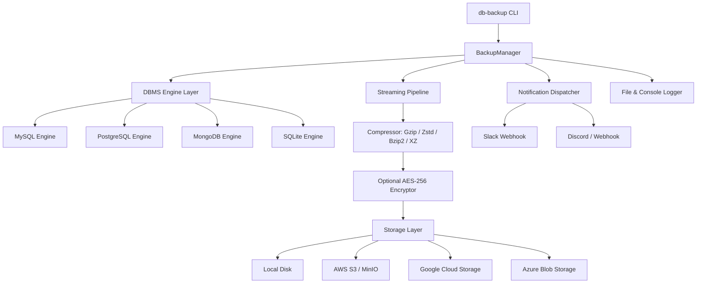

# 🛡️ Database Backup Utility (`db-backup`)

A high-performance, cross-platform Command-Line Interface (CLI) utility for automating database backup, streaming compression, cloud storage synchronization, scheduling, notifications, and selective recovery across multiple Database Management Systems (DBMS).

---

## 🌟 Key Features

- **Multi-DBMS Support**:
  - 🐬 **MySQL / MariaDB** (via native `mysqldump` or high-performance streaming Python `pymysql` server-side cursor fallback)
  - 🐘 **PostgreSQL** (via native `pg_dump` or streaming `psycopg2` server-side cursor fallback)
  - 🍃 **MongoDB** (via native `mongodump` archive or streaming `pymongo` BSON/Extended JSON fallback)
  - 🪶 **SQLite** (atomic snapshots via Python's native SQLite C-API & structured SQL dumps)
- **Zero-Dependency Fallback (Dual-Engine Architecture)**:
  - Works seamlessly even if native database client binaries (`mysqldump`, `pg_dump`, `mongodump`) are not installed on the host system.
- **Multiple Backup Types**:
  - `full`: Complete database snapshot (schema + data + indexes).
  - `incremental`: Only records/collections modified since the last backup.
  - `differential`: Changes relative to the most recent full backup.
- **Streaming Compression**:
  - Compresses dumps on-the-fly without exhausting RAM.
  - Supported algorithms: `gzip`, `bzip2`, `zstd` (Zstandard), `xz`, `zip`, or `none`.
  - Configurable compression level (1–9).
- **Security & Integrity**:
  - SHA-256 integrity checksum verification.
  - Optional **AES-256** encryption using PBKDF2 key derivation.
  - Safe credential masking across all logs and CLI outputs.
- **Flexible Storage Targets**:
  - 💾 **Local Storage**: Configurable directories with automatic retention pruning.
  - ☁️ **AWS S3 / S3-Compatible**: AWS S3, MinIO, Wasabi, Cloudflare R2.
  - ☁️ **Google Cloud Storage (GCS)**: Service account and project support.
  - ☁️ **Azure Blob Storage**: Connection string / container management.
- **Automated Scheduling**:
  - Built-in daemon mode (`--minutes`, `--hours`, `--daily-at HH:MM`, `--hourly`).
  - OS-native generator for Linux/macOS `crontab` and Windows Task Scheduler (`schtasks`).
- **Selective Restore & Recovery**:
  - Restore complete databases or specific tables (`--table <name>`) and collections (`--collection <name>`).
- **Rich Logging & Slack Notifications**:
  - Beautiful interactive terminal output with progress indicators and tables (Rich).
  - Machine-readable JSON structured logs and file logging.
  - Slack incoming webhook alerts with execution metrics, timing, and error traces.

---

## 📐 Architecture Overview



---

## 🚀 Installation

### 1. Clone & Install
```bash
git clone <repository_url>
cd "Database Backup Utility"

# Install in editable mode
pip install -e .
```

Verify installation:
```bash
db-backup --version
db-backup --help
```

---

## ⚡ Quickstart Examples

### 1. Pre-Flight Connection Test
Validate database credentials before running backups:
```bash
# SQLite
db-backup test --type sqlite --database ./data/my_app.db

# MySQL
db-backup test --type mysql --host localhost --port 3306 --username root --password secret --database production_db

# PostgreSQL
db-backup test --type postgres --host localhost --port 5432 --username postgres --password secret --database analytics

# MongoDB
db-backup test --type mongodb --host localhost --port 27017 --database app_db
```

---

### 2. Performing Backups

#### SQLite Local Backup with Gzip
```bash
db-backup backup --type sqlite --database ./data/my_app.db --compression gzip --storage local --local-path ./backups
```

#### MySQL Backup to AWS S3 with Zstandard Compression
```bash
db-backup backup \
  --type mysql \
  --host db.internal \
  --username root \
  --password secret \
  --database shop_db \
  --compression zstd \
  --compression-level 3 \
  --storage s3 \
  --s3-bucket my-backup-bucket \
  --s3-prefix mysql-prod \
  --s3-region us-east-1
```

#### PostgreSQL Encrypted Backup
```bash
db-backup backup \
  --type postgres \
  --host localhost \
  --database analytics \
  --encrypt \
  --encryption-key "YourStrongPassphrase123!"
```

#### Selective Table Backup (MySQL / Postgres / SQLite)
```bash
db-backup backup \
  --type sqlite \
  --database ./app.db \
  --table users \
  --table orders
```

#### Backup with Slack Notification
```bash
db-backup backup \
  --type mysql \
  --database prod \
  --slack-webhook "https://hooks.slack.com/services/T00/B00/X00"
```

---

### 3. Restoring Backups

#### Full Database Restore
```bash
db-backup restore --type sqlite --database ./restored_app.db ./backups/my_app_full_20261101.sql.gz
```

#### Selective Table Restore
Restore only the `users` table from a backup file:
```bash
db-backup restore \
  --type sqlite \
  --database ./restored_app.db \
  --table users \
  ./backups/my_app_full_20261101.sql.gz
```

#### Restoring an Encrypted Backup
```bash
db-backup restore \
  --type postgres \
  --database analytics \
  --encryption-key "YourStrongPassphrase123!" \
  ./backups/analytics_full.sql.gz.enc
```

---

### 4. Listing & Pruning Backups

```bash
# List all stored backups
db-backup list --storage local --local-path ./backups

# Prune older backups: keep the 5 most recent
db-backup prune --retention-count 5 --local-path ./backups

# Prune backups older than 30 days
db-backup prune --retention-days 30 --local-path ./backups
```

---

## ⏰ Automated Scheduling

### Built-in Daemon Mode
Run the utility continuously in the background or as a system service:
```bash
# Run backup every 30 minutes
db-backup schedule run -p production_mysql --minutes 30

# Run daily at 02:30 AM with an immediate initial backup
db-backup schedule run -p production_mysql --daily-at "02:30" --run-now
```

### Generate Native Crontab (Linux/macOS)
```bash
db-backup schedule generate-cron -p production_mysql --cron-expr "0 3 * * *"
```
Output:
```text
# Database Backup Utility Cron Job
0 3 * * * db-backup backup -p production_mysql >> /var/log/db_backup_cron.log 2>&1
```

### Generate Windows Task Scheduler
```bash
db-backup schedule generate-task -p production_mysql --time 03:00
```
Output:
```bat
schtasks /create /tn "DBBackup_production_mysql" /tr "db-backup.exe backup -p production_mysql" /sc daily /st 03:00 /ru SYSTEM
```

---

## ⚙️ Configuration File (`backup_config.yaml`)

To avoid repeating connection strings and parameters, create a configuration file:

```bash
db-backup config init
```

Sample configuration (`backup_config.yaml`):

```yaml
default_profile: local_sqlite

profiles:
  local_sqlite:
    database:
      type: sqlite
      database: ./data/app.db
    storage:
      type: local
      local_path: ./backups
    options:
      backup_type: full
      compression: gzip
      compression_level: 6

  production_mysql:
    database:
      type: mysql
      host: localhost
      port: 3306
      username: root
      password: "${MYSQL_PWD}"
      database: production_db
    storage:
      type: s3
      s3_bucket: my-company-backups
      s3_prefix: mysql-prod
      s3_region: us-east-1
    options:
      backup_type: full
      compression: zstd
      retention_count: 14
    notification:
      slack_webhook_url: "https://hooks.slack.com/services/T00/B00/X00"
      notify_on_success: true
      notify_on_failure: true
```

List profiles:
```bash
db-backup config list
```

Run with profile:
```bash
db-backup backup -p production_mysql
```

---

## 🧪 Running Tests

The test suite covers all DBMS engines, compression formats, encryption, retention policies, and CLI workflows:

```bash
pytest -v
```

---

## 📋 CLI Reference Summary

| Command | Description |
| :--- | :--- |
| `db-backup test` | Tests credentials and database connectivity. |
| `db-backup backup` | Executes a full, incremental, or differential backup. |
| `db-backup restore <file>` | Restores a database or selective tables/collections. |
| `db-backup list` | Displays stored backup archives and metadata. |
| `db-backup prune` | Removes older backups based on retention rules. |
| `db-backup schedule run` | Runs automatic recurring backup daemon. |
| `db-backup schedule generate-cron` | Outputs Linux/macOS crontab definition. |
| `db-backup schedule generate-task` | Outputs Windows `schtasks` definition. |
| `db-backup config init` | Generates a sample `backup_config.yaml`. |
| `db-backup config list` | Lists all defined configuration profiles. |

---

## 📄 License
This project is licensed under the MIT License.